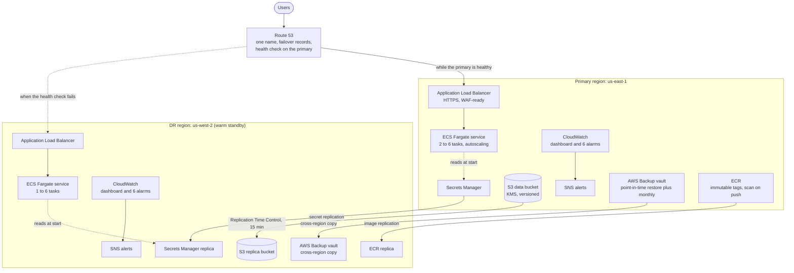

# Containerized App on ECS Fargate with Observability and Disaster Recovery

[](https://github.com/WillFarid/containerized-app-with-observability-and-DR/actions/workflows/terraform-ci.yml)

A containerized web service on AWS ECS Fargate, built with Terraform in two regions: a primary that serves traffic and a warm standby in a second region that takes over when Route 53 declares the primary unhealthy. Alarms, a dashboard, replicated data and secrets, and immutable backups come with it.

> Validated and planned (**190 resources**), and every pull request is checked by CI.

## Architecture



## What is built

| Layer | What | Notes |
|---|---|---|
| **Network** | One VPC module used twice (`10.10.0.0/16` and `10.20.0.0/16`) | The second call passes `providers = { aws = aws.dr }`. Ranges are validated not to overlap. NAT per AZ in the primary, one shared NAT in DR. |
| **Images** | ECR repository per region | Immutable tags, scan on push, KMS encryption, lifecycle policy, automatic replication to the DR region |
| **Compute** | ECS Fargate service per region | Non-root user, read-only root filesystem, no public IP, deployment circuit breaker with automatic rollback, the `latest` tag is rejected by a validation |
| **Entry point** | Application Load Balancer per region | HTTPS with a TLS 1.3 policy, HTTP only redirects, invalid headers dropped, access logs to an encrypted bucket |
| **Secrets** | Secrets Manager secret with a replica in the DR region | Created empty so the value never reaches code or state. Injected by ECS at task start. |
| **IAM** | Separate execution role and task role per region | The execution role reads exactly one secret. The task role reads and writes one bucket prefix and uses one key. |
| **Autoscaling** | CPU and request-count target tracking | Scale out in 60 s, scale in after 300 s |
| **Observability** | Dashboard and six alarms per region, encrypted SNS topic | Alarms cover errors, unhealthy tasks, p95 latency, CPU, memory and missing capacity |
| **Data** | S3 bucket replicated to the DR region | Replication Time Control, a KMS key per region, versioning, a replication-lag alarm |
| **Backup** | AWS Backup with point-in-time restore (35 days) and monthly copies (365 days) | A vault per region, both locked, failed jobs notify |
| **Failover** | Route 53 failover records and a health check | An alarm tells the team when the primary is declared unhealthy |

**14 CloudWatch alarms in total:** six service alarms in each region, one replication-lag alarm and one failover alarm.

## Recovery objectives

These are **design targets**, derived from the configuration.

| Target | Value | Where it comes from |
|---|---|---|
| **RPO** (data you can afford to lose) | 15 minutes | S3 Replication Time Control replicates 99.99% of objects within 15 minutes, and an alarm watches the latency |
| **RTO** (time to recover) | 10 minutes | Detection takes up to 90 s (30 s checks, 3 failures), DNS caches expire within 60 s, the standby already runs, and autoscaling reaches full capacity in roughly 2 to 5 more minutes |

Replication and backup protect against different things. Replication gives a fast failover but copies mistakes as fast as it copies data. Backup keeps history, so any second of the last 35 days can be restored.

## Design decisions

| Decision | Why |
|---|---|
| **Warm standby** | Pilot light is slower to recover and active-active costs double. A warm standby can meet the RTO at a middle cost. |
| **One state, two providers** | Both regions are one system, so they live in one root module with a default provider and an `aws.dr` alias. |
| **Reuse proven modules** | The VPC module comes from the 3-tier project and the ALB module from the same design, changed only where Fargate needs it (target type `ip`). |
| **Unique names per copy** | IAM is global, so each copy of a module gets a different name prefix. |
| **Everything the standby needs is replicated ahead of time** | The image, the secret, the data and the backups. Recovery means adding capacity, not building anything. |
| **Task role separate from execution role** | A compromised app cannot use the permissions ECS needs to start it. |
| **Secrets created empty** | The value is set once, out of band. It never appears in code, Git or state. |
| **Immutable image tags** | `1.0.0` always means the same scanned image, and deployments are reproducible. |
| **Alarms chosen by the question they answer** | Is it erroring, healthy, slow, out of CPU or memory, missing capacity. |
| **Vault Lock (governance mode)** | Recovery points cannot be deleted early. Compliance mode is a deliberate production decision. |

## Repository structure

```text
.
├── .github/workflows/terraform-ci.yml   # fmt, validate, tflint, checkov, container test and plan on every pull request
├── app/                                 # the demo service and its Dockerfile
├── modules/
│   ├── vpc/            # network (used in both regions)
│   ├── alb/            # load balancer, listeners, access logs
│   ├── ecr/            # image repository with replication
│   ├── ecs-service/    # cluster, roles, task definition, service, autoscaling
│   ├── secrets/        # secret with a replica in the DR region
│   ├── monitoring/     # six alarms, dashboard, encrypted alerts topic
│   ├── storage/        # replicated data bucket (the RPO)
│   ├── backup/         # vaults, plan, point-in-time restore, vault lock
│   └── dns-failover/   # Route 53 health check, failover records, failover alarm
├── environments/prod/  # root module that wires everything together
└── docs/dr-runbook.md
```

Each module has its own generated README (inputs, outputs, resources) produced by `terraform-docs`.

## Quality gates

Every commit runs through [pre-commit](https://pre-commit.com), and every pull request runs the same checks in GitHub Actions behind a single required status check:

| Check | Purpose |
|---|---|
| `terraform fmt` and `terraform validate` | Formatting and syntax |
| `tflint` | AWS-aware linting |
| `checkov` | Security scanning |
| Container build and test | Builds the image, starts it, and checks the health endpoint and the non-root user |
| `terraform plan` (offline) | Proves the configuration builds, and posts the summary on the pull request |
| `terraform-docs` | Auto-generated module documentation |

## Running it offline

```bash
cd environments/prod

# Local-only override that swaps the S3 backend for a local one (gitignored)
cat > backend_override.tf <<'EOT'
terraform {
  backend "local" {
    path = "terraform.tfstate"
  }
}
EOT

terraform init -reconfigure
terraform validate
terraform plan
```

To run the container locally (needs Docker):

```bash
docker build -t demo-app ./app
docker run --rm -p 8080:8080 -e APP_REGION=local demo-app
curl localhost:8080/health
```

## Disaster recovery runbook

[`docs/dr-runbook.md`](docs/dr-runbook.md) covers the first deployment order, failover, failback, restoring from backup, a game-day test plan and what to check when each alarm fires.

## What I would add next

- AWS WAF on both load balancers.
- Scheduled restore testing with AWS Backup, so every backup is proven restorable.
- A customer-managed key for the CloudWatch log groups.
- Reverse replication for an automated failback.
- A regular failover game day, recording the measured RTO.
- VPC endpoints for ECR, CloudWatch Logs and Secrets Manager in place of NAT gateways.
- Deployment automation with OIDC and approval-gated environments, as in the [Terraform CI/CD repository](https://github.com/WillFarid/terraform-CI-CD-with-security-and-policy-gates).

## Skills demonstrated

Terraform modules with multi-region providers, ECS Fargate and container hardening, load balancing and TLS, autoscaling, CloudWatch alarms and dashboards, Secrets Manager and KMS, cross-region replication (ECR, secrets and S3), AWS Backup and Vault Lock, Route 53 failover, least-privilege IAM, and CI with GitHub Actions.

## 👩‍💻 Author

**Will Farid**

Cloud Engineer

## ⭐ Support

If you found this project useful, consider giving it a ⭐ on GitHub.
